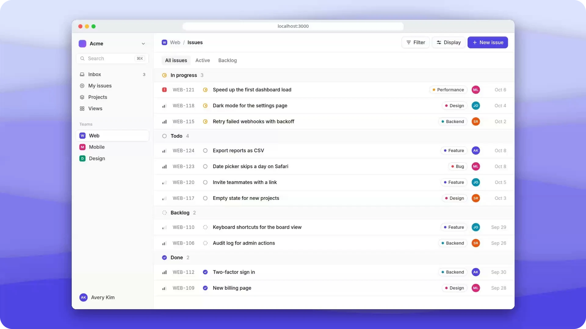

<div align="center">

<h1>
  <picture>
    <source media="(prefers-color-scheme: dark)" srcset="./assets/logo-wordmark-dark.svg" />
    
  </picture>
</h1>

**Ask your AI agent for a demo video.** It clicks through your web app and hands back a polished MP4 that zooms in on each click. Works with Claude Code, Codex, VS Code, Gemini CLI, Cursor, Claude Desktop and any other agent that supports MCP, or on its own as a CLI.

[Website](https://cursorcam.vercel.app) &nbsp;·&nbsp; [Changelog](./CHANGELOG.md) &nbsp;·&nbsp; [Contributing](./CONTRIBUTING.md)

<p>
  <a href="https://www.npmjs.com/package/cursorcam"></a>
  <a href="https://github.com/Avijit07x/cursorcam/stargazers"></a>
  <a href="https://github.com/Avijit07x/cursorcam/graphs/contributors"></a>
  <a href="https://github.com/Avijit07x/cursorcam/commits"></a>
  <a href="./LICENSE"></a>
</p>

</div>

<a href="./assets/demo.mp4"></a>

<p align="center"><sub>Made with CursorCam from 13 steps. <a href="./assets/demo.mp4">Watch the full-quality MP4</a> (1080p, 60 fps).</sub></p>

---

## Setup

**You need** Node.js 22.13+ and Chrome, Edge, Chromium or Brave 120+. CursorCam uses the browser you already have and downloads nothing.

**Install it in your agent:**

| Agent | Install |
| --- | --- |
| Claude Code | `/plugin marketplace add Avijit07x/cursorcam`, then `/plugin install cursorcam@cursorcam` and `/reload-plugins` |
| Codex | `codex plugin marketplace add Avijit07x/cursorcam`, then `codex plugin add cursorcam@cursorcam` |
| VS Code and GitHub Copilot | Add `Avijit07x/cursorcam` to `chat.plugins.marketplaces`, then install it from `@agentPlugins` |
| Gemini CLI | `gemini extensions install https://github.com/Avijit07x/cursorcam` |
| Cursor | [One-click MCP install](./docs/agents.md#cursor) |
| Claude Desktop | Open [`cursorcam.mcpb`](https://github.com/Avijit07x/cursorcam/releases/latest/download/cursorcam.mcpb) |
| Any other app | The MCP server, `npx -y cursorcam mcp`. See the [MCP guide](./docs/mcp.md) |

[Your AI agent](./docs/agents.md) has each one step by step.

**Then ask for a video:**

```
Make a 20 second demo of http://localhost:3000: sign up and create a project.
```

You get `video.mp4` (1080p, 60 fps) and a `poster.jpg` thumbnail in a run folder inside `cursorcam-output/`. Add that folder to `.gitignore`.

## How it works

Your agent explores your app, writes the steps and records them in a hidden browser. Then it checks stills of the video and fixes anything that looks wrong.

If it needs a login or a 2FA code, it asks you. What you type is used for that run only and never saved.

## Use the CLI

The MCP server and the plugins run the `cursorcam` CLI. You can run it yourself too:

```bash
npx cursorcam doctor
npx cursorcam run steps.json
```

```json
{
  "url": "http://localhost:3000",
  "steps": [
    { "click": "role=button[name='Get started']" },
    { "type": "alex@example.com", "into": "label=Email" },
    { "press": "Enter" },
    { "waitFor": "text=Dashboard" }
  ]
}
```

## Docs

| Guide | Covers |
| --- | --- |
| [Getting started](./docs/getting-started.md) | Set up CursorCam and make your first video |
| [Your AI agent](./docs/agents.md) | Install it in Claude Code, Codex, VS Code, Gemini CLI, Cursor or Claude Desktop |
| [MCP server](./docs/mcp.md) | Set it up by hand in any MCP app, and every tool it offers |
| [Better videos](./docs/better-videos.md) | How to ask your AI agent, with example requests and tips |
| [Steps file](./docs/steps.md) | Every action, target and option |
| [Look and size](./docs/style.md) | Presets for X, LinkedIn, YouTube and Discord, formats, backgrounds and zoom |
| [Logins and secrets](./docs/logins.md) | Passwords, 2FA codes and saved logins |
| [CLI](./docs/cli.md) | Every command, the run folder and exit codes |
| [Troubleshooting](./docs/troubleshooting.md) | Common errors and how to fix them |
| [Examples](./docs/examples/) | Steps and style files to copy and edit |

## Contributing

Bug reports and pull requests are welcome. See [CONTRIBUTING.md](./CONTRIBUTING.md). To report a security problem, see [SECURITY.md](./SECURITY.md).

## License

[Apache-2.0](./LICENSE)
